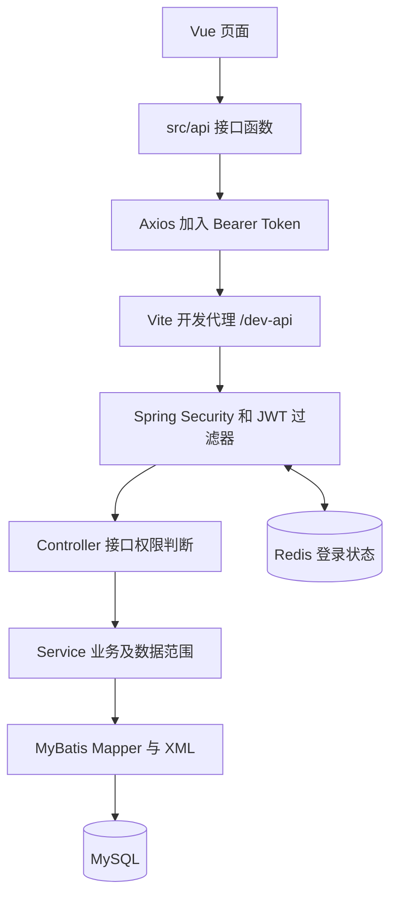

# 项目使用说明书

| 项目 | 说明 |
|---|---|
| 文档版本 | 1.3 |
| 编写日期 | 2026-10-25 |
| 更新日期 | 2026-10-26 |
| 适用项目 | 当前工作区的若依 Spring Boot 3＋Vue3 管理后台 |
| 项目目录 | `D:\桌面文件\大四上文件\码\ry` |
| 主要读者 | 系统管理员、普通使用者、开发人员、部署维护人员 |
| 内容依据 | 当前源码、数据库初始化脚本、启动脚本和验证脚本 |
| 文档格式 | Markdown，可使用 VS Code 的 Markdown 预览阅读 |

本文说明当前已经存在的管理后台功能及其使用方式。界面菜单和按钮会随角色授权变化；文中的初始账号、参数初始值和目录配置，以本地实际修改后的结果为准。

## 目录

1. [适用范围与功能边界](#scope)
2. [十分钟快速使用](#quickstart)
3. [项目结构与运行原理](#architecture)
4. [环境与本机配置](#environment)
5. [首次部署与数据库初始化](#initialize)
6. [启动、停止、重建与验证](#lifecycle)
7. [登录、个人中心与界面操作](#account)
8. [组织与人员管理](#organization)
9. [角色、菜单与权限配置](#permission)
10. [字典与参数设置](#configuration)
11. [通知公告](#notice)
12. [日志、在线用户与系统监控](#monitor)
13. [定时任务](#scheduler)
14. [表单构建工具](#formbuilder)
15. [代码生成完整操作流程](#generator)
16. [接口文档与接口调试](#api)
17. [开发修改与资源替换](#development)
18. [构建、部署与迁移](#deployment)
19. [数据维护与备份恢复](#maintenance)
20. [常见问题处理](#troubleshooting)
21. [推荐演示与检查流程](#demonstration)
22. [后续考勤业务扩展边界](#roadmap)
23. [配置、表结构和源码索引](#reference)

<a id="scope"></a>
## 1. 适用范围与功能边界

### 1.1 当前项目是什么

当前项目是一套前后端分离的管理后台：

- 后端：RuoYi-Vue 的 Spring Boot 3 版本，Java 17，Maven 多模块组织，单体运行。
- 前端：RuoYi-Vue3 JavaScript 版本，Vue3、Vite、Element Plus、Pinia、Axios。
- 数据库：MySQL 8。
- 缓存：Redis，用于登录状态、验证码、字典、参数等。
- 权限：Spring Security、JWT、角色权限、菜单和按钮权限、部门数据范围。

当前交付以本地 Windows 开发运行方式为主。`start-dev.ps1` 启动的是后端 JAR 和 Vite 开发服务。

### 1.2 当前包含的功能

| 分类 | 功能 |
|---|---|
| 账号与个人功能 | 登录、验证码、退出、个人资料、头像、修改密码、锁屏 |
| 系统管理 | 用户、角色、菜单、部门、岗位、字典、参数、通知公告 |
| 考勤基础数据 | 办公场所管理、员工档案、账号一对一关联与主要办公场所绑定 |
| 扫码签到 | 签到场次、Redis 动态二维码凭证、H5 登录与确认签到、本人及管理端原始记录查询 |
| 规则配置 | 每个场所一套固定班次，配置工作日、上下班、跨天、宽限、打卡窗口和休息时长，预览计划工时 |
| 日志管理 | 操作日志、登录日志 |
| 系统监控 | 在线用户、定时任务、数据监控、服务监控、缓存监控和缓存列表 |
| 系统工具 | 表单构建、代码生成、接口文档 |
| 界面功能 | 工作台、菜单搜索、页签、全屏、主题和布局配置 |

### 1.3 已清理的框架示例

- `/test/user` 内存模拟用户接口及其 `TestController`。
- `RyTask` 示例任务类和三条示例任务配置。
- 示例普通用户、示例部门和岗位、示例公告。
- 重复后端目录、旧浏览器提示页。

初始化 SQL 当前保留管理员账号、默认部门、角色和支撑系统功能所需的菜单、字典及参数。岗位、公告和任务初始为空属于正常现象。

### 1.4 尚未实现的业务

当前已经实现办公场所管理、手工坐标保存、员工业务档案和主要办公场所绑定，完整操作见 [办公场所与员工档案使用说明](办公场所与员工档案使用说明.md)。签到场次、动态二维码、H5 登录 / 确认签到 / 本人记录和管理端原始签到记录查询也已实现，操作与规则见 [扫码签到使用说明](扫码签到使用说明.md)。第三方地图坐标采集、人脸识别、考勤计算、考勤看板、Agent、知识库、小程序等尚未接入；原始签到次数不能直接当作出勤天数或工时。

固定班次参数维护已实现，见 [考勤规则配置使用说明](考勤规则配置使用说明.md)。当前仅保存与预览配置，不按规则拦截现有扫码、不自动计算迟到、早退、缺卡或实际工时。

<a id="quickstart"></a>
## 2. 十分钟快速使用

本节适用于当前机器已经完成依赖安装和数据库初始化的情况。

### 2.1 启动

在 PowerShell 中进入项目根目录：

```powershell
Set-Location -LiteralPath 'D:\桌面文件\大四上文件\码\ry'
./start-dev.ps1
```

看到以下提示表示脚本已完成 HTTP 就绪检查：

```text
Ready. Frontend: http://localhost  Backend: http://localhost:8080
Logs: .runtime/logs
```

### 2.2 登录

1. 浏览器打开 `http://localhost`。
2. 输入初始化管理员账号 `admin`。
3. 如果尚未改过密码，输入初始化密码 `admin123`。
4. 按验证码图片填写验证码；数学验证码填写计算结果。
5. 点击“登录”。

登录页面不再预填账号密码。登录成功后进入工作台，左侧显示当前账号有权访问的菜单。

### 2.3 推荐首次操作

1. 在个人中心检查资料和密码。
2. 在“系统管理 → 部门管理”建立实际部门。
3. 按需要建立岗位。
4. 建立测试角色，配置菜单权限和数据范围。
5. 建立普通测试用户，分配部门、岗位和角色。
6. 用另一浏览器会话登录测试用户，检查菜单、按钮和数据范围。

### 2.4 验证与停止

```powershell
./verify-dev.ps1
./stop-dev.ps1
```

验证脚本会实际登录管理员、读取数据并退出，会产生相应登录日志；它不是只读的端口检测。脚本当前使用初始化管理员密码，密码已修改时需调整脚本中的测试登录信息。

<a id="architecture"></a>
## 3. 项目结构与运行原理

### 3.1 根目录

```text
ry/
├─ Vue-springboot3/             后端源码
├─ Vue3-master/                 前端源码
├─ docs/                        项目文档
├─ test/                        考勤基础数据与扫码签到专项验证
├─ .runtime/                    本地配置、日志、上传文件及依赖缓存
├─ start-dev.ps1                启动和可选构建
├─ stop-dev.ps1                 停止本项目记录的进程
└─ verify-dev.ps1               基础联调检查
```

`.runtime/` 已被根目录 `.gitignore` 排除。迁移或重新拉取源码时，需要单独准备本地配置；依赖缓存本身可以重新下载。

### 3.2 后端模块

| 模块 | 用途 |
|---|---|
| `ruoyi-admin` | 启动入口、主要系统和监控 Controller、应用配置 |
| `ruoyi-framework` | 安全认证、JWT、权限服务、数据范围切面、框架配置 |
| `ruoyi-system` | 系统业务 Service、Mapper、Mapper XML 及相关实体 |
| `ruoyi-common` | 公共实体、工具、异常、注解、Redis 封装 |
| `ruoyi-quartz` | 定时任务的接口、业务、调度和执行日志 |
| `ruoyi-generator` | 数据库表元数据、生成配置和代码模板 |
| `ruoyi-attendance` | 场所、员工、场次、签到与记录；按 Controller、Service 接口及 Impl、Mapper/XML、实体与 DTO/VO 分层 |

这些模块最终由 `ruoyi-admin` 组合成一个运行包。修改 `system`、`framework` 等被依赖模块后，也需要重新构建后端运行包。

### 3.3 前端目录

| 目录或文件 | 用途 |
|---|---|
| `src/views` | 登录、工作台、系统管理、监控、工具页面 |
| `src/api` | 按功能划分的后端接口函数 |
| `src/router` | 固定路由及部分需要权限判断的辅助路由 |
| `src/store` | 用户、权限、布局、页签、锁屏等 Pinia 状态 |
| `src/layout` | 后台外框、侧边栏、顶部栏、页签和消息通知 |
| `src/components` | 分页、上传、富文本、字典标签等公共组件 |
| `src/directive` | 按钮权限、角色权限等指令 |
| `src/utils/request.js` | Axios 请求、Token 请求头、错误处理和下载 |
| `src/permission.js` | 登录校验、路由守卫和动态路由加载 |
| `public` | 按原名访问的静态资源 |
| `dist` | 前端构建结果，可以重新生成 |

### 3.4 请求链路



以用户列表为例：页面调用 `listUser()`，请求 `/dev-api/system/user/list`，开发代理移除 `/dev-api` 后转发给后端；后端检查 `system:user:list`，再执行带数据范围条件的查询。

H5 使用 `/h5/login`、`/h5/checkin`、`/h5/records` 固定路由和独立移动布局，复用同一 JWT 登录接口。扫码请求由服务端取得本人身份、检查 Redis 凭证并保存原始记录。管理端仍使用动态菜单、按钮权限与部门数据范围，没有引入微服务或另一套认证。

<a id="environment"></a>
## 4. 环境与本机配置

### 4.1 环境记录

| 组件 | 当前源码要求或本机记录 |
|---|---|
| JDK | 源码目标 Java 17；本机 Maven 使用 JDK 17.0.8 |
| Maven | 本机 3.9.9 |
| Spring Boot | 根 POM 配置 3.5.16 |
| Node.js | 本机 v20.18.0 |
| MySQL | 已连接使用的本机版本记录为 8.0.37 |
| Redis | 当前启动脚本使用本机 Redis 5.0.14.1 |
| Vue | `package.json` 配置 3.5.26 |
| Vite | `package.json` 配置 6.4.1 |
| Element Plus | `package.json` 配置 2.13.1 |

这些是当前实施配置，不代表课程原方案指定了相同版本。Redis 8.2.1 的本机 MSYS2 程序此前启动崩溃，当前使用已有的 Redis 5.0.14.1 运行本地开发；该处理属于本机环境适配。

可执行以下命令检查工具是否可用：

```powershell
java -version
mvn.cmd -version
node --version
npm.cmd --version
$env:JAVA_HOME
```

启动脚本实际使用 `$env:JAVA_HOME/bin/java.exe`，因此只配置 PATH 不足以满足脚本要求。Maven 和启动脚本应使用同一套 JDK 17。

### 4.2 地址与端口

| 服务 | 默认地址 | 说明 |
|---|---|---|
| 前端 | `http://localhost` 或 `http://127.0.0.1` | 端口 80；脚本绑定回环地址 |
| 后端 | `http://localhost:8080` | Spring Boot |
| MySQL | `127.0.0.1:3306` | 数据库 `ry-vue` |
| Redis | `127.0.0.1:6379` | 当前配置使用第 0 号逻辑数据库 |
| Swagger UI | `http://localhost:8080/swagger-ui/index.html` | 也可从系统工具进入 |
| OpenAPI | `http://localhost:8080/v3/api-docs/default` | 当前实际系统接口分组 |

### 4.3 本地配置

本地连接信息位于 `.runtime/application-local.yml`。下面是结构示例，密码占位符必须替换为实际值：

```yaml
ruoyi:
  profile: ../.runtime/uploads
spring:
  datasource:
    druid:
      master:
        url: jdbc:mysql://127.0.0.1:3306/ry-vue?useUnicode=true&characterEncoding=utf8&useSSL=false&allowPublicKeyRetrieval=true&serverTimezone=Asia/Shanghai
        username: root
        password: "替换为本机数据库密码"
  data:
    redis:
      host: 127.0.0.1
      port: 6379
      database: 0
```

启动脚本加载后端打包配置及外部 `druid,local` 配置，外部本地配置覆盖相同的基础配置项。直接启动 JAR 却没有附带外部配置参数，可能连接到源码中的默认数据源配置。

相对上传目录由后端工作目录解析。当前脚本将后端工作目录设为 `Vue-springboot3`，因此 `../.runtime/uploads` 指向项目根目录下的 `.runtime/uploads`。

<a id="initialize"></a>
## 5. 首次部署与数据库初始化

### 5.1 已初始化机器

当前机器已使用 `ry-vue` 数据库完成初始化。日常启动无需重新导入 SQL。

`ry_20260417.sql` 和 `quartz.sql` 含有删除后重建表的语句。只能在确认使用空库或已备份的初始化环境中执行，不能当作日常升级命令。

### 5.2 在空环境初始化

1. 安装并启动 MySQL 8。
2. 使用有建库权限的账号创建 `ry-vue`，字符集使用 `utf8mb4`。
3. 进入后端 SQL 目录。
4. 使用 MySQL 命令行交互输入密码。

```powershell
Set-Location -LiteralPath 'D:\桌面文件\大四上文件\码\ry\Vue-springboot3\sql'
& 'D:/MySQL/MySQL Server 8.0/bin/mysql.exe' --host=127.0.0.1 --user=root --default-character-set=utf8mb4 -p
```

进入 MySQL 交互界面后执行：

```sql
CREATE DATABASE IF NOT EXISTS `ry-vue`
  DEFAULT CHARACTER SET utf8mb4
  COLLATE utf8mb4_unicode_ci;
USE `ry-vue`;
SOURCE ry_20260417.sql;
SOURCE quartz.sql;
SOURCE attendance-base.sql;
SOURCE attendance-checkin.sql;
SOURCE attendance-rule.sql;
SHOW TABLES;
SELECT user_id, user_name, nick_name, dept_id FROM sys_user;
```

按上述五份脚本应建立36张表：20张系统/生成业务表、11张 Quartz 表和5张考勤业务表。已有扫码签到模块的库升级规则配置只需执行 `attendance-rule.sql`；尚未安装考勤基础模块则先执行 `attendance-base.sql`，扫码功能还需 `attendance-checkin.sql`。不要重跑系统初始化脚本。创建 Quartz 表不代表当前已开启 JDBC 持久化调度，见定时任务章节。

新数据库应有 `admin` 管理员和默认部门。用户名、部门名显示乱码时，应先检查 SQL 文件 UTF-8 编码和客户端字符集，再继续录入业务资料。

### 5.3 旧演示数据清理脚本

`Vue-springboot3/sql/cleanup-demo.sql` 用于匹配并清理框架原始示例记录，包括官网菜单、模拟用户、示例公告及任务。当前环境此前已执行。

它不是初始化脚本，也不是通用清空数据库脚本。新环境直接使用当前已经清理过的初始化 SQL 即可。对已有真实业务库应用清理脚本前，应先核对被匹配的记录。

### 5.4 安装依赖和首次构建

完成数据库与本地配置后，从根目录执行：

```powershell
./start-dev.ps1 -Build
```

脚本会执行后端 Maven 打包及前端 npm 安装，然后启动服务。首次下载依赖需要网络，耗时取决于网络和镜像速度。

<a id="lifecycle"></a>
## 6. 启动、停止、重建与验证

### 6.1 日常启动

```powershell
./start-dev.ps1
```

脚本的主要步骤：

1. 创建日志目录，检查本地配置文件。
2. 检查本机 MySQL 3306 端口。
3. 如果指定 `-Build`，先打包后端、安装前端依赖。
4. 如果 6379 未监听，使用脚本中的 Redis 程序路径启动 Redis。
5. 如果 8080 未监听，使用 JDK 17 启动后端 JAR。
6. 如果 80 未监听，启动 Vite 开发服务。
7. 检查验证码接口和前端页面是否返回 HTTP 200。

脚本不会自动安装软件、创建数据库或启动 MySQL 系统服务。若端口已被其他程序占用，它可能跳过该服务的启动；“端口有监听”并不证明监听者是本项目。

前端依赖尚未安装时，脚本可能先启动后端并提示缺少前端依赖。完成依赖安装后再次执行即可。

### 6.2 停止

```powershell
./stop-dev.ps1
```

停止脚本按前端、后端、Redis 的顺序检查进程记录，核对 PID 和启动时间后停止对应进程。它不会停止 MySQL 服务，也不会删除数据库、上传文件或源码。

若 Redis 是此前手动启动并被脚本复用的，脚本没有为该实例创建进程记录，停止脚本不会将其停止。服务运行期间不要随意删除 `.runtime/*-process.json`。

### 6.3 修改后重新运行

| 修改内容 | 常规操作 |
|---|---|
| Vue、JS、样式、源码图片 | 开发服务通常热更新；刷新页面确认 |
| `.env.*`、Vite 配置 | 重启前端；生产构建需重新打包 |
| Java、Mapper XML、打包内 YAML、模板 | 重新构建后端并重启 |
| 外部 `.runtime/application-local.yml` | 重启后端 |
| 菜单、角色、用户授权 | 按界面保存，受影响账号重新登录核验 |

Java 修改后的便捷方式：

```powershell
./stop-dev.ps1
./start-dev.ps1 -Build
```

删除或重命名 Java 类时，推荐在停止服务后执行干净构建，避免旧 class 残留：

```powershell
Set-Location -LiteralPath './Vue-springboot3'
mvn.cmd '-Dmaven.repo.local=../.runtime/m2' -B -DskipTests clean package
Set-Location -LiteralPath '..'
./start-dev.ps1
```

`-DskipTests` 表示跳过测试。构建成功只证明完成了该次编译打包，不等于模块测试、压力测试或全部业务验收通过。

### 6.4 联调验证

```powershell
./verify-dev.ps1
```

当前验证范围：

- 前端 HTML 和入口 JS 可以访问。
- 未登录请求受保护接口被拒绝。
- 验证码可生成并写入 Redis。
- 管理员可以通过前端代理登录。
- 用户信息、菜单、用户列表、公告和任务接口正常返回。
- 接口文档包含实际系统接口，且没有原演示用户接口。
- 原宣传菜单、示例公告、示例任务未重新出现。
- 退出后旧 Token 不能继续获取用户信息。

脚本从本机 Redis 读取该次测试验证码来完成自动联调，页面验证码功能仍然开启。它还使用固定 Redis CLI 路径和默认管理员密码；更换环境、修改端口或密码后需同步调整。

该脚本不会全面验证每个按钮、浏览器布局、普通角色越权、并发性能或未来考勤功能。

<a id="account"></a>
## 7. 登录、个人中心与界面操作

### 7.1 登录与验证码

- 输入账号、密码、验证码后提交。
- 点击验证码图片可重新获取；重新获取后使用新图片的结果。
- 数学验证码填写计算结果，字符验证码按图片内容填写。
- 当前源码配置密码错误上限为 5 次，达到阈值后按配置锁定 10 分钟；修改外部配置后以实际生效值为准。
- “记住密码”在本浏览器保存相应登录信息；共享电脑不建议勾选。

账号停用或删除后无法正常通过新的登录认证。对已经存在的在线会话，还需要结合强退和重新登录处理，不能仅凭界面状态推断其即时失效。

### 7.2 个人中心

通过右上角头像/昵称菜单进入“个人中心”：

1. 在基本资料中修改允许编辑的个人信息。
2. 点击头像选择图片并裁剪上传。
3. 在密码页填写旧密码、新密码和确认密码。
4. 保存后按界面提示重新登录或确认新信息。

密码页面当前包含 6～20 位长度及字符规则校验。修改密码后，`verify-dev.ps1` 中固定的管理员测试密码不会自动更新。

### 7.3 锁屏与退出

- 右上角菜单“锁定屏幕”进入锁屏页面，使用当前账号密码解锁。
- 锁屏属于当前前端会话的界面功能，不代表服务器已退出登录。
- “退出登录”会调用后端退出逻辑，删除相应 Redis 登录记录，再清理前端状态。
- 离开共享电脑时使用退出登录。

### 7.4 导航和布局

- 左侧菜单由后端权限菜单生成。
- 顶部页签可在已打开页面之间切换。
- 菜单搜索用于定位当前有权访问的页面。
- 主题按钮切换明暗模式。
- 布局设置提供导航模式、页签、固定头部、Logo、动态标题等选项。
- “保存配置”保存到当前浏览器本地，其他浏览器或设备不会自动同步。

刷新后仍显示旧布局时，可以使用界面中的重置布局功能；只清理布局相关浏览器存储即可，不必清空整个网站的全部数据。

<a id="organization"></a>
## 8. 组织与人员管理

### 8.1 部门管理

入口：**系统管理 → 部门管理**。

基本操作：

1. 搜索部门名称和状态。
2. 点击新增，选择上级部门。
3. 填写部门名称、显示排序、负责人、电话、邮箱和状态。
4. 保存后检查树形关系。
5. 需要调整时点击对应行的修改。

部门用于用户归属及数据范围。存在下级部门、用户或其他业务关联时，删除可能被后端拒绝；先处理关联，避免直接在数据库中删除部门造成断链。

当前默认部门可根据实际组织进行调整。办公场所已有独立业务页面，按管理部门应用数据范围；公司、子公司尚无独立业务档案。员工档案的所属部门跟随关联账号当前部门。

### 8.2 岗位管理

入口：**系统管理 → 岗位管理**。

可维护岗位编码、岗位名称、排序、状态和备注，并按条件查询、导出。新建用户或修改用户时可选择已启用岗位。

岗位主要表达组织任职信息，菜单和接口权限由角色承担。创建“经理”岗位不会自动赋予管理权限。当前岗位列表初始为空，需要按实际组织建立。

### 8.3 新增用户

入口：**系统管理 → 用户管理**。

1. 点击“新增”。
2. 填写昵称、用户名称和密码。
3. 选择归属部门。
4. 按需填写手机号、邮箱、性别。
5. 选择岗位和角色，确认状态为正常。
6. 保存后搜索该账号，确认数据存在。
7. 使用独立浏览器会话登录该账号检查授权结果。

用户名称要求唯一；填写了手机号或邮箱时，后端会检查相应唯一性。可选择的部门和角色也受当前操作者的数据权限限制。

初始化管理员密码为 `admin123`；新增用户表单的初始密码由参数 `sys.user.initPassword` 控制，SQL 初始值是 `123456`。两者用途不同，创建时以表单实际填写的密码为准。

### 8.4 查询、修改与状态管理

- 可以按用户名称、手机号、状态、创建时间及左侧部门树筛选。
- 修改用于调整昵称、联系方式、部门、岗位和角色等资料。
- 分配角色可以从用户行上的相应按钮进入，也可从角色管理分配用户。
- 重置密码由有权限的管理员执行，通常不需要提供该用户旧密码。
- 停用可阻止新的正常登录；需要立即结束已有会话时，同时在在线用户页面强退。
- 删除和批量操作需要核对选中对象，后端会检查数据范围及超级管理员保护规则。

超级管理员账号不能按普通用户的方式随意修改或删除。管理员自身资料和密码优先通过个人中心维护。

### 8.5 导入与导出

1. 在用户管理点击导入，并下载页面提供的模板。
2. 按模板填写字段和格式，不要自行修改列名。
3. 先准备少量测试行，核对部门等关联值。
4. 选择是否更新已存在用户后提交。
5. 阅读成功、失败数量及具体提示，修正失败记录后再导入。

导入可能部分成功，应以实际返回结果和列表为准。导出通常按当前筛选条件及操作者权限获取数据；需要少量数据时先筛选再导出。

<a id="permission"></a>
## 9. 角色、菜单与权限配置

### 9.1 权限模型

```text
用户 → 用户角色关联 → 角色 → 角色菜单关联 → 菜单/按钮及权限标识
                         └→ 数据范围 → 部门或本人范围
```

| 控制层 | 作用 |
|---|---|
| 路由菜单 | 控制账号加载哪些页面入口 |
| 按钮权限 | 控制新增、修改、删除、导出等按钮是否显示 |
| 接口权限 | 后端检查当前用户是否能调用该方法 |
| 数据范围 | 限制查询或操作能涉及哪些记录 |

前端隐藏按钮用于界面控制，真正的请求仍由后端判断。仅添加菜单或按钮配置，不会自动给新增 Controller 加上权限检查。

### 9.2 新建角色

入口：**系统管理 → 角色管理**。

1. 点击新增。
2. 填写角色名称，例如“用户资料查看员”。
3. 填写唯一角色权限字符，例如 `user_viewer`。
4. 设置显示顺序和正常状态。
5. 展开菜单权限树，勾选目标目录、页面及需要的操作权限。
6. 保存。

角色权限字符如 `user_viewer` 与操作权限字符如 `system:user:list` 是不同概念。前者标识角色，后者标识具体操作。

初始化脚本仍保留名为“普通角色”的 `common` 角色及其菜单授权。“普通角色”这个名称不代表它已经按你的业务配置成最小权限；使用前应检查授权树。

### 9.3 分配用户

方式一：进入用户管理，新增或修改用户时选择角色。

方式二：进入角色管理的分配用户功能，从未分配用户列表中选择并授权，或取消已有授权。

一个用户可以拥有多个角色。满足条件的角色权限通常合并；测试某个角色时，应确认测试账号没有同时持有额外高权限角色。

### 9.4 配置数据范围

在角色管理中打开该角色的数据权限配置：

| 范围 | 含义 |
|---|---|
| 全部数据 | 不按所属部门限制该范围内的数据 |
| 自定义数据 | 按勾选部门形成范围 |
| 本部门数据 | 仅当前用户所属部门 |
| 本部门及以下数据 | 所属部门及下级部门 |
| 仅本人数据 | 仅与当前用户对应的记录 |

保存后，使用普通测试账号重新登录验证。超级管理员用户 ID 为 1，具有特殊权限并跳过数据范围过滤，不适合用来测试受限角色。

数据范围需要业务代码接入：Service 使用 `@DataScope`，Mapper SQL 引入相应条件；具体记录操作还可能调用 `checkUserDataScope`。自行新增业务表后，不会自动获得这些约束。

### 9.5 配置菜单

入口：**系统管理 → 菜单管理**。

| 类型 | 用途 | 主要填写项 |
|---|---|---|
| 目录 M | 容纳下级页面 | 上级菜单、名称、路由、排序、图标 |
| 菜单 C | 对应具体页面 | 路由、组件路径、权限字符、显示与状态 |
| 按钮 F | 对应页面操作 | 名称、权限字符、排序；通常不产生页面路由 |

例如用户管理页面组件路径为 `system/user/index`，对应 `src/views/system/user/index.vue`，不填写 `.vue` 后缀。

操作权限示例：

```text
system:user:list       查询列表
system:user:add        新增
system:user:edit       修改
system:user:remove     删除
system:user:export     导出
system:user:resetPwd   重置密码
```

“显示/隐藏”用于控制导航展示，不等同于接口授权。配置了一个组件路径但没有创建相应 Vue 文件时，页面无法正常加载。

### 9.6 权限生效与验证

当前“编辑角色”路径已调用在线权限刷新，更新相关在线用户的 Redis 操作权限缓存。前端菜单和按钮还需要重新加载；用户角色分配、数据范围和角色状态变化没有统一接入所有在线会话刷新路径。

推荐验证步骤：

1. 修改角色并保存。
2. 受影响用户退出后重新登录。
3. 检查菜单是否出现。
4. 检查操作按钮是否符合授权。
5. 检查列表、详情、导出是否仅包含授权数据。
6. 检查直接请求未授权接口是否被拒绝。

不能只凭菜单消失就认定后端权限已经完整实现。

<a id="configuration"></a>
## 10. 字典与参数设置

### 10.1 字典管理

入口：**系统管理 → 字典管理**。

字典分为类型和数据项：类型如 `sys_normal_disable`，数据项是该类型下的标签和值。

操作流程：

1. 新增字典类型，填写名称、唯一类型标识和状态。
2. 从字典数据入口进入条目列表。
3. 新增标签、字典键值、排序、状态及样式信息。
4. 保存后在相应页面检查下拉选项或标签。

字典的值用于数据存储，标签用于展示。更改已经被业务数据引用的值，需要同时考虑历史数据；仅更改标签一般不改变数据库中的值。

如果更新后页面未变化，可使用字典刷新缓存功能，并刷新页面。不要随意删除系统状态、性别、任务分组等已有类型。

### 10.2 参数设置

入口：**系统管理 → 参数设置**。

参数以“参数键名—参数键值”形式保存。新增参数只有在代码读取该键时才会产生业务效果。

| 参数键名 | 初始化值 | 作用 |
|---|---|---|
| `sys.user.initPassword` | `123456` | 新增用户表单初始密码 |
| `sys.account.captchaEnabled` | `true` | 登录验证码开关 |
| `sys.account.registerUser` | `false` | 后端自助注册开关 |
| `sys.login.blackIPList` | 空 | 登录 IP 黑名单 |
| `sys.account.initPasswordModify` | `1` | 初始密码修改提醒 |
| `sys.account.passwordValidateDays` | `0` | 密码更新周期，0 为不限制 |
| `sys.account.chrtype` | `0` | 密码字符范围配置 |

密码字符范围：0 为页面允许的一般字符，1 为数字，2 为英文字母，3 为字母和数字组合，4 为字母、数字及指定特殊字符组合。当前页面还会排除若干非法字符，实际以校验提示为准。

源码中还保留了默认皮肤、侧边栏主题等历史参数。当前 Vue3 布局主要由 `src/settings.js`、Pinia 和浏览器本地设置控制，不应假定每一个旧参数都能改变当前界面。

### 10.3 注册功能的当前限制

后端读取 `sys.account.registerUser` 判断是否允许注册，但当前登录页面中的注册入口变量默认写为关闭。因此只修改数据库参数，不保证登录页自动出现“立即注册”。

若确实需要自助注册，应同时检查前端入口、后端开关、新用户角色和注册后的授权流程。本手册日常使用流程采用管理员创建用户。

<a id="notice"></a>
## 11. 通知公告

入口：**系统管理 → 通知公告**。

### 11.1 新建与维护

1. 点击新增。
2. 填写公告标题。
3. 选择通知或公告类型。
4. 设置正常或关闭状态。
5. 使用富文本编辑器填写内容。
6. 保存后点击标题查看详情。

当前没有独立的审批流或单独的“审批发布”环节。列表初始为空，是因为框架示例公告已清理。

### 11.2 阅读状态

- 顶部消息通知会获取正常公告并显示当前用户已读状态。
- 当前顶部接口最多返回 5 条记录，角标未读数按这批返回记录计算，不应作为全库公告未读总量。
- 用户查看并标记已读后，系统写入公告阅读记录。
- 有权限的管理员可在公告管理中查看“阅读用户”。

删除公告后，相关内容不能再按原页面继续阅读。批量操作前应确认选中的公告范围。

<a id="monitor"></a>
## 12. 日志、在线用户与系统监控

### 12.1 操作日志

入口通常为 **系统管理 → 日志管理 → 操作日志**。

用于按模块、操作人、业务类型、状态和时间查询操作记录，查看请求信息、执行结果或异常等。它主要记录接入了日志注解的操作，不保证每一次普通查询都会产生操作日志。

导出用于留存分析；清空或删除会影响历史追踪，应在明确保留要求后执行。

### 12.2 登录日志

入口通常为 **系统管理 → 日志管理 → 登录日志**。

可查看成功、失败和退出等登录信息，辅助定位密码错误、验证码错误和账号状态问题。解锁操作用于处理相应账号的登录失败限制；不要把解锁当作修改密码。

### 12.3 在线用户

入口：**系统监控 → 在线用户**。

在线信息来自 Redis 登录记录。管理员可以按条件查询，并对目标会话执行强退。强退后该 Token 的后续请求需要重新登录。

同一账号可能存在多个会话，操作前应检查会话与登录信息。当前浏览器是否已经打开页面，不等于服务器中必然仍有有效登录记录。

### 12.4 数据监控

入口：**系统监控 → 数据监控**。

页面通过 iframe 打开 Druid 监控界面，用于查看数据源、连接池和 SQL 等信息。Druid 有独立的监控登录配置，不使用普通系统账号密码自动完成登录。

账号配置位置为 `application-druid.yml` 下的 `statViewServlet`，也可能被外部配置覆盖。本文不复制本机监控凭据；需要时查看实际配置并由维护人员提供。

### 12.5 服务监控

入口：**系统监控 → 服务监控**。

可查看服务器 CPU、内存、JVM、系统、磁盘等运行信息。它反映部署后端的机器，不是当前访问者手机或电脑的完整监控信息。

### 12.6 缓存监控与缓存列表

| 功能 | 用途 |
|---|---|
| 缓存监控 | 查看 Redis 基本信息、命令统计、内存等 |
| 缓存列表 | 查看缓存分类、键和值，并按界面能力清理 |

常见缓存前缀：

```text
login_tokens:     在线登录状态
captcha_codes:    验证码
sys_config:       系统参数
sys_dict:         字典
pwd_err_cnt:      密码错误计数
repeat_submit:    防重复提交
```

清理 `login_tokens:` 会影响在线用户；清理验证码会使尚未提交的验证码失效。排查单项缓存问题时，先定位具体分类或键。

<a id="scheduler"></a>
## 13. 定时任务

入口：**系统监控 → 定时任务**。

### 13.1 当前状态

原 `RyTask` 类及其无参、有参、多参三条演示任务已删除。任务列表为空时，调度管理功能仍然存在，但当前没有可直接填写原演示方法执行的业务任务。

新增任务前，开发人员必须先实现并部署实际可调用的方法。

### 13.2 新建任务

1. 确认目标 Java 类或 Spring Bean 已存在于运行包。
2. 确认方法为可调用的 public 方法，参数类型与填写内容一致。
3. 点击新增，填写任务名称、分组、调用目标、Cron 表达式。
4. 设置执行策略及是否允许并发。
5. 初次保存时保持暂停，检查配置。
6. 手动执行一次并查看调度日志。
7. 确认结果后再启用定时执行。

调用格式示意：

```text
实际Bean名称.实际方法名()
实际Bean名称.实际方法名('字符串参数')
完整类名.实际方法名()
```

这些是格式说明，不能原样填入。完整类名方式通过创建类实例调用，依赖 Spring 注入的任务通常应使用实际注册的 Bean 方式。

当前任务调用白名单包含 `com.ruoyi.quartz.task`。任务放到其他包或新业务模块后，开发人员需要检查调用校验与依赖配置，不应简单取消校验。

### 13.3 Cron 表达式

Quartz 常用格式为“秒 分 时 日 月 周”，可包含年：

| 表达式 | 含义 |
|---|---|
| `0 0/5 * * * ?` | 每 5 分钟执行 |
| `0 0 2 * * ?` | 每天 02:00 执行 |
| `0 0 9 ? * MON-FRI` | 周一至周五 09:00 执行 |

可以使用页面的 Cron 编辑工具辅助生成。执行时间以调度器实际时区为准；跨时区部署应先确认服务器和业务时区。

执行策略处理错过触发时间后的行为；是否并发决定同一任务前一次未结束时是否允许重叠执行。对结算、写库、发消息等任务，应在业务实现中处理幂等。

### 13.4 管理和日志

- 启用/暂停：改变后续调度状态。
- 执行一次：立即触发，需要检查是否会重复修改业务数据。
- 调度日志：查看调用目标、耗时、状态及异常。
- 删除：移除该条任务配置，不能回滚它此前已经产生的业务结果。

当前 `ScheduleConfig.java` 中 JDBC 持久化配置处于注释状态，调度默认使用内存方式，业务任务配置保存在 `sys_job`。数据库存在 `QRTZ_*` 表不等于当前已经使用这些表进行调度持久化。

<a id="formbuilder"></a>
## 14. 表单构建工具

入口：**系统工具 → 表单构建**。

操作步骤：

1. 从左侧点选或拖入输入、选择、布局组件。
2. 在中间区域调整组件顺序。
3. 选中组件，在右侧设置标签、字段名、宽度、选项、校验等属性。
4. 调整表单标签位置、间距等全局配置。
5. 使用“复制代码”或“导出 vue 文件”保存结果。
6. 将导出的代码放入真实业务页面，并接入接口和状态处理。

表单构建工具生成的是前端表单代码，不会自动创建数据库表、Controller、角色授权或业务流程。上传控件等组件需要填写真实接口；当前已移除外部模拟上传地址。

清空操作针对当前设计内容。重要设计应先导出或纳入版本管理，不能把浏览器中暂存的内容当作唯一交付文件。

<a id="generator"></a>
## 15. 代码生成完整操作流程

入口：**系统工具 → 代码生成**。本节面向有建表和代码集成能力的开发人员。

### 15.1 生成器能生成什么

根据表结构和字段配置生成实体、Controller、Service、Mapper、Mapper XML、前端 API、Vue 页面及菜单 SQL。适合基础维护功能的起步。

签到校验、人脸识别、业务审批、跨表事务、工时计算等逻辑仍需自行实现。

### 15.2 准备数据表

1. 先确定表的业务含义、字段、主键和关联关系。
2. 为表和字段填写明确注释。
3. 确认字段类型与 Java 类型对应关系，日期、金额、状态等类型尤其要核对。
4. 在当前后端连接的数据库中创建表。

下面只用于说明新业务的命名关系，当前项目尚未建立班次业务表：

```text
表名：att_shift
表描述：考勤班次
主键：shift_id
字段示意：shift_name、start_time、end_time、status
```

当前已建立独立 `ruoyi-attendance` 模块；新功能应按现有结构接入。不要用生成结果直接覆盖已经包含业务校验和数据范围的场所、员工代码。生成器不会自动完成模块架构设计。

### 15.3 导入表

1. 点击“导入”。
2. 按表名称或表描述搜索。
3. 勾选需要生成的表。
4. 确定后进入生成配置列表。

这里导入的是数据库结构元数据，不是 Excel 业务数据。已导入的表通常不会再次出现在待导入列表中。

页面还提供创建表能力，实际会执行建表语句；只在明确理解 SQL 的情况下使用。日常修改业务数据不使用这个功能。

### 15.4 基本信息与字段配置

进入编辑，检查表名称、表描述、实体类名、作者和备注等。

字段配置逐项检查：

| 配置项 | 需要核对的内容 |
|---|---|
| Java 类型/属性 | 是否与数据库语义对应，命名是否合理 |
| 主键、自增 | 是否符合真实表结构 |
| 插入/编辑 | 是否允许在表单中维护该字段 |
| 列表 | 是否显示，是否存在敏感字段 |
| 查询 | 是否需要作为搜索条件 |
| 查询方式 | 等于、模糊、范围等是否适合该字段 |
| 必填 | 前端和后端是否都需要验证 |
| 显示组件 | 输入框、选择、日期、上传、富文本等 |
| 字典类型 | 是否已在系统字典中维护，存储值是否一致 |

不要把密码、私密凭据或后续人脸特征等字段直接作为普通列表列导出。

### 15.5 生成信息

| 配置 | 当前项目应如何处理 |
|---|---|
| 生成模板 | 按需求选择单表、树表或主子表 |
| 前端模板 | 选择 **Vue3 Element Plus 模板**，即 JavaScript 版本 |
| 包路径 | 当前默认 `com.ruoyi.system`；新业务包需要主动调整 |
| 模块名/业务名 | 与接口路径、文件目录、权限前缀共同核对 |
| 功能名 | 用作页面及菜单相关名称 |
| 上级菜单 | 选择实际要挂载的目录 |
| 生成方式 | 当前优先选择 ZIP 压缩包 |

当前导入页面会传入 `element-plus` 模板类型，编辑页面也提供其他前端模板；不要误选 Vue2 或 TypeScript 模板。

树表还需要配置树 ID、父 ID、名称字段；主子表需要配置关联表和关联字段。选择模板本身不会补齐数据库约束。

当前 `generator.yml` 的 `allowOverwrite` 为 `false`，自定义路径生成会被后端拒绝。下载 ZIP、检查后再集成即可，无需为普通使用强行打开覆盖功能。

### 15.6 预览与下载

1. 保存配置。
2. 点击预览，检查 Java、XML、Vue、API 和菜单 SQL。
3. 核对权限标识、包名、接口路径、字段校验和 SQL。
4. 生成并下载 ZIP。
5. 解压到临时目录，逐文件比对后放入项目。

重复生成前应备份已有业务修改。生成器不知道哪些内容是你手写的业务规则，不能自动保证保留全部改动。

### 15.7 集成到当前项目

| 文件 | 通常的集成位置 |
|---|---|
| 实体、Service、Mapper Java | 当前 `ruoyi-system` 或实际新增业务模块 |
| Mapper XML | 所属模块 `src/main/resources/mapper/...` |
| Controller | 当前通常放入 `ruoyi-admin`，或按实际模块结构放置 |
| 前端 API | `Vue3-master/src/api/...` |
| Vue 页面 | `Vue3-master/src/views/...` |
| 菜单 SQL | 审查后在目标数据库执行 |

包路径、扫描范围和依赖必须一致。不能只看生成 ZIP 的目录名就不加检查地覆盖现有模块。

集成后：

1. 检查并执行生成的菜单 SQL，避免菜单 ID、路径和权限重复。
2. 在角色管理中授予新页面和操作权限。
3. 重新构建并启动后端。
4. 刷新前端或重新构建部署。
5. 使用有权限和无权限的账号分别测试。
6. 补充数据范围、关联校验、事务、边界条件及业务测试。

### 15.8 同步与删除

- 数据库结构变更后，可用“同步”更新生成器中的字段元数据，再重新检查字段配置。
- 同步元数据不会自动升级已经集成的 Java 和 Vue 文件，也不会执行你的业务数据库迁移。
- 删除生成配置主要删除生成器元数据，不等同于删除真实数据库业务表或已放入源码的文件。

<a id="api"></a>
## 16. 接口文档与接口调试

### 16.1 打开文档

入口：**系统工具 → 系统接口**，或访问 `http://localhost:8080/swagger-ui/index.html`。

当前 OpenAPI 分组扫描 `com.ruoyi`，显示实际系统、任务和生成等接口。原 `/test/user` 演示接口已删除。

### 16.2 身份信息

请求受保护接口时使用：

```http
Authorization: Bearer <登录返回的token>
```

在 Swagger 的授权输入框中，当前配置把 `Authorization` 作为请求头；通常需要填写完整的 `Bearer ` 前缀和 Token。Token 是会话凭据，不要贴入公开文档或提交进仓库。

可以从本人已授权的浏览器开发者工具 Network 请求头或正常登录接口返回值中取得该次会话 Token。验证码登录需要使用有效验证码，不能拿旧图片结果反复提交。

### 16.3 常见接口

| 接口 | 方法 | 用途 |
|---|---|---|
| `/captchaImage` | GET | 获取验证码及 UUID |
| `/login` | POST | 提交账号、密码和验证码登录 |
| `/getInfo` | GET | 当前用户、角色、权限 |
| `/getRouters` | GET | 当前用户可加载的菜单路由 |
| `/logout` | POST | 退出会话 |
| `/system/user/list` | GET | 用户分页列表 |
| `/system/role/list` | GET | 角色列表 |
| `/system/notice/list` | GET | 公告管理列表 |
| `/monitor/job/list` | GET | 定时任务列表 |

在本地前端同源请求中，这些路径前加 `/dev-api`；直接请求后端 8080 端口时，不加 `/dev-api`。生产前缀由 `.env.production` 和反向代理决定。

### 16.4 阅读返回值

普通接口一般使用 `code`、`msg` 和 `data`，分页列表常见 `rows`、`total`。具体以对应接口文档和实际返回为准。

当前很多错误通过 JSON 中的业务码表达，HTTP 200 不代表业务一定成功。调试时同时检查 HTTP 状态、响应 `code`、`msg` 和后端日志。

接口文档中的“执行”会真实调用接口。涉及删除、强退、改密、生成文件和任务执行时，操作对象必须是已确认的测试对象。

<a id="development"></a>
## 17. 开发修改与资源替换

### 17.1 修改页面标题与布局

- 页面标题：前端 `.env.development`、`.env.production`、`.env.staging` 中的 `VITE_APP_TITLE`。
- 默认布局：`src/settings.js`。
- 运行后当前浏览器布局：布局设置及浏览器本地存储。
- 工作台内容：`src/views/index.vue`。
- 公共图标：`public/favicon.svg`。

修改环境变量后重启 Vite；生产环境需重新构建。仅修改开发环境文件不会自动改变已部署的生产文件。

### 17.2 修改登录背景

当前登录页浅色和深色样式都引用：

```text
Vue3-master/src/assets/images/login-background-custom.jpg
```

该图片由此前提供的 `dist/static/jpg/login-background.jpg` 复制到源码目录，确保重新构建后仍能使用。

更新背景时应替换源码图片或修改 `src/views/login.vue` 中的引用。当前注册页仍使用原来的 `login-background.jpg`，两个页面可以独立维护。

`dist` 是构建输出目录，Vite 构建可能清空并重建它；只向 `dist` 放图或手改生成的 CSS，不能作为可持续的源码修改。

### 17.3 新增业务页面

典型步骤：

1. 设计表和业务接口。
2. 新建实体、Service、Mapper/XML、Controller。
3. 给接口添加相应权限判断及必要的数据范围。
4. 在 `src/api` 编写接口函数。
5. 在 `src/views` 创建页面。
6. 创建菜单和按钮权限，给角色授权。
7. 用普通账号测试完整链路。

通常由后台菜单生成动态路由，不需要给每个维护页面都在 `router/index.js` 手写固定路由。登录页、独立移动页、特殊辅助页等再按实际设计配置。

### 17.4 修改后端配置

源码配置位于 `ruoyi-admin/src/main/resources`。通过当前脚本运行时，外部本地配置可能覆盖源码值；排查配置时同时检查两处。

新增业务模块时，还需检查 Maven 聚合、`ruoyi-admin` 依赖、Mapper/XML 资源路径、实体扫描及组件扫描。只增加一个文件夹不会自动形成可运行模块。

<a id="deployment"></a>
## 18. 构建、部署与迁移

### 18.1 后端构建

从项目根目录执行：

```powershell
Set-Location -LiteralPath './Vue-springboot3'
mvn.cmd '-Dmaven.repo.local=../.runtime/m2' -B -DskipTests clean package
Set-Location -LiteralPath '..'
```

主要产物为 `Vue-springboot3/ruoyi-admin/target/ruoyi-admin.jar`。不要把 `jar.original` 当作可直接运行的最终包。

### 18.2 前端构建

```powershell
Set-Location -LiteralPath './Vue3-master'
npm.cmd install --cache ../.runtime/npm-cache --no-audit --no-fund
npm.cmd run build:prod
Set-Location -LiteralPath '..'
```

产物位于 `Vue3-master/dist`。生产模式请求前缀为 `/prod-api`。

`npm.cmd run build:stage` 使用 staging 环境配置。`npm.cmd run preview` 用于查看构建结果；当前 Vite 实现会在未单独配置时继承 `server.proxy`，但本项目代理配置主要匹配 `/dev-api`，生产包使用的却是 `/prod-api`。未补充匹配的预览代理或生产反向代理时，页面可能打开但接口失败。预览服务不应作为正式部署方式。

### 18.3 静态站点与反向代理

正式部署可以让 Web 服务器提供 `dist`，并将 `/prod-api/` 转发到后端。下面是与当前路径规则匹配的 Nginx 配置片段示意，需要合并到实际服务器配置中：

```nginx
server {
    listen 80;
    server_name localhost;
    root D:/apps/ry/web;
    index index.html;
    client_max_body_size 20m;

    location / {
        try_files $uri $uri/ /index.html;
    }

    location /prod-api/ {
        proxy_pass http://127.0.0.1:8080/;
        proxy_set_header Host $host;
        proxy_set_header X-Real-IP $remote_addr;
        proxy_set_header X-Forwarded-For $proxy_add_x_forwarded_for;
    }
}
```

将 `dist` 内容部署到实际静态根目录。`proxy_pass` 末尾的 `/` 在该配置中用于去除 `/prod-api/` 前缀，规则见 [Nginx proxy_pass 官方说明](https://nginx.org/en/docs/http/ngx_http_proxy_module.html#proxy_pass)。`try_files` 用于 Vue History 路由刷新时返回入口页面，规则见 [Nginx try_files 官方说明](https://nginx.org/en/docs/http/ngx_http_core_module.html#try_files)。

该示例是部署说明，仓库当前没有因此自动安装或启用 Nginx，也没有完成公网 HTTPS、Docker、CI/CD、云效或 Kubernetes 部署。正式部署应使用实际域名、HTTPS、持久化目录和受控的数据库/缓存连接配置。

### 18.4 迁移到其他电脑

需要准备或迁移：

1. 前后端源码和文档。
2. 数据库结构及需要保留的数据。
3. `.runtime/application-local.yml` 中与目标环境匹配的配置。
4. 上传文件目录。
5. JDK、Maven、Node、MySQL、Redis 环境。
6. 新环境中的启动方式和端口。

需要调整的本机耦合项：

- `start-dev.ps1` 中 Redis 可执行文件路径。
- `verify-dev.ps1` 中 Redis CLI、端口及测试账号。
- `.runtime/initialize-db.ps1` 若仍使用，检查其中的 MySQL 路径及凭据处理；优先按第 5 章交互式初始化。
- `JAVA_HOME` 和 Maven/Node 的 PATH。
- 外部配置中的数据库、缓存、上传路径。

当前启动脚本和验证脚本固定使用端口 80、8080、3306、6379。修改 YAML 或 Vite 配置里的端口时，需要同步调整脚本、代理和访问地址。

<a id="maintenance"></a>
## 19. 数据维护与备份恢复

### 19.1 数据分布

| 数据 | 保存位置 | 说明 |
|---|---|---|
| 用户、角色、菜单等 | MySQL | 核心业务持久化数据 |
| 登录、验证码、字典/参数缓存 | Redis | 不等于 MySQL 全量备份 |
| 头像、上传附件 | `.runtime/uploads` 或实际配置目录 | 数据库备份不会自动包含图片文件 |
| 进程和错误信息 | `.runtime/logs` | 用于诊断和追踪 |
| 布局和部分前端偏好 | 当前浏览器 | 与其他浏览器不自动同步 |
| 生成配置 | `gen_table`、`gen_table_column` | 与数据库表结构及已集成源码分开维护 |

当前脚本启动 Redis 时关闭 RDB 定时保存与 AOF。该实例重启后，在线登录记录等缓存可能丢失，需要重新登录；MySQL 中的用户和角色不会因此被删除。

### 19.2 数据库备份示例

在本机 MySQL 工具路径有效的前提下：

```powershell
New-Item -ItemType Directory -Force './.runtime/backups' | Out-Null
$backupFile = Join-Path (Resolve-Path -LiteralPath './.runtime/backups').Path 'ry-vue-backup.sql'
& 'D:/MySQL/MySQL Server 8.0/bin/mysqldump.exe' --host=127.0.0.1 --user=root -p --default-character-set=utf8mb4 --single-transaction "--result-file=$backupFile" '--databases' 'ry-vue'
```

使用工具本身的 `--result-file` 避免不同 PowerShell 版本重定向文本时改变 SQL 编码。备份前确认所用账号有权限，备份后检查文件和命令退出状态。需要时另外备份存储过程、事件等非当前基础表对象。

同时备份上传目录和必要配置，私密连接信息应受控保存。

### 19.3 恢复

恢复前先停止本项目，确认目标库和备份内容，并保留当前状态的备份。在 MySQL 客户端中执行备份文件对应的 `SOURCE`。

备份可能包含删表或建库语句，恢复目标必须核对。恢复数据库后，再恢复上传文件及对应配置，启动服务并检查账号、菜单、图片和业务记录。

不要用重新导入初始化 SQL 的方式修复普通登录、权限或接口错误。

<a id="troubleshooting"></a>
## 20. 常见问题处理

### 20.1 排查顺序

先看脚本提示，再看端口和日志，最后检查浏览器 Network 中的实际请求和响应。区分前端未启动、代理错误、后端未启动、认证失败及业务校验失败。

从根目录读取日志：

```powershell
Get-Content .runtime/logs/backend.out.log -Tail 100
Get-Content .runtime/logs/backend.err.log -Tail 100
Get-Content .runtime/logs/frontend.err.log -Tail 100
Get-Content .runtime/logs/redis.err.log -Tail 100
```

`backend.out.log` 也可能包含异常信息，不能只检查 `backend.err.log`。

### 20.2 问题对照表

| 现象 | 重点检查 | 处理方向 |
|---|---|---|
| `Missing .runtime/application-local.yml` | 本地文件不存在 | 按配置示例准备真实本地配置 |
| `JAVA_HOME must point to JDK 17` | JAVA_HOME 路径及 bin/java.exe | 配置 JDK 17 后重新打开终端 |
| `MySQL is not listening on port 3306` | MySQL 服务、实际端口 | 启动 MySQL；改端口时同步改脚本 |
| `Access denied for user` | 用户名、密码、账号连接权限 | 修改实际生效的本地数据源配置 |
| `Unknown database` 或缺表 | 库名和初始化情况 | 核对目标库，不要向已有库盲目重新导入 |
| Redis 启动失败 | 程序路径、端口、错误日志 | 使用本机可运行版本或先手动启动实例 |
| 前端页面打不开 | 80 端口、frontend 日志 | 检查依赖、启动进程和占用者 |
| 页面能开但提示后端连接异常 | 8080、代理目标、请求前缀 | 核对后端和 `/dev-api` 映射 |
| 刷新后登录失效 | Redis 重启、Token 过期或强退 | 重新登录；查看缓存服务是否稳定 |
| 验证码反复错误 | 新旧 UUID、图片结果、Redis | 刷新验证码并用新结果提交 |
| 账号锁定 | 密码错误计数和锁定时间 | 等待配置时间，或由授权管理员处理 |
| 菜单不显示 | 角色、菜单状态、父级和授权 | 保存后用目标账号重新登录 |
| 按钮不显示 | 操作权限、前端指令、角色合并 | 核对具体 `system:...` 权限标识 |
| 页面有按钮但接口拒绝 | 后端注解、在线权限缓存 | 检查响应内容并重新登录验证 |
| 有查询权限但列表为空 | 数据范围、所属部门、搜索条件 | 用受限账号核对部门和角色范围 |
| 菜单点击后空白 | 组件路径、文件位置、浏览器异常 | 确认 `system/.../index` 对应真实 Vue 文件 |
| 数据监控要求再次登录 | Druid 独立账号 | 检查 statViewServlet 实际配置 |
| 任务报 Bean/方法不存在 | 目标代码是否部署、参数类型 | 不能调用已删除的 `ryTask` 演示方法 |
| 生成器找不到表 | 数据源、表名、是否已导入 | 确认表在当前连接数据库中 |
| 生成到自定义路径被拒绝 | allowOverwrite=false | 使用 ZIP 下载检查后集成 |
| 生成页面存在但没有菜单 | 菜单 SQL 和角色授权 | 集成菜单后重新加载权限 |
| 修改 Java 后无变化 | 实际运行的是旧 JAR | 重新构建、停止并启动 |
| 修改背景后重新构建又恢复 | 是否只改了 dist | 修改源码资源和页面引用 |
| 静态部署刷新子路由 404 | History 路由回退 | 配置静态服务器返回 index.html |
| 生产接口 404 | `/prod-api` 转发和去前缀 | 核对生产环境变量及反向代理 |
| 验证脚本登录失败 | 管理员密码和 Redis CLI | 同步脚本测试配置，避免反复失败触发锁定 |

### 20.3 端口与网络说明

可使用以下命令查找监听进程：

```powershell
netstat -ano -p tcp | Select-String ':80\s|:8080\s|:3306\s|:6379\s'
```

先核对进程归属，再决定是否停止。不要直接批量结束所有 Java、Node、MySQL 或 Redis 进程。

当前脚本把前端绑定到 `127.0.0.1`。其他设备上的 `localhost` 指向其他设备自身，不能据此访问这台电脑。手机联调需要单独配置监听地址、可达网络、代理和相应访问地址；当前本地启动成功不代表已支持公网或手机访问。

<a id="demonstration"></a>
## 21. 推荐演示与检查流程

### 21.1 管理员操作演示

1. 启动服务并打开登录页。
2. 输入验证码登录，展示工作台和布局设置。
3. 新建一个演示部门和岗位。
4. 新建受限角色，仅授予用户列表和必要查看权限。
5. 新建普通测试用户并关联部门、岗位和角色。
6. 发布一条测试公告，查看详情与阅读状态。
7. 展示登录日志、操作日志和服务监控。
8. 展示实际接口文档。

### 21.2 普通角色验证

1. 使用独立浏览器会话登录测试用户。
2. 确认只显示授权菜单。
3. 确认新增、修改、删除等未授权按钮不出现。
4. 由有权限的测试人员验证直接访问未授权接口会被后端拒绝。
5. 配置两个部门的数据，验证数据范围。
6. 调整角色后重新登录，确认结果变化。

### 21.3 开发工具演示

1. 在开发库准备一张测试业务表。
2. 导入代码生成器，选择 Vue3 Element Plus 模板。
3. 展示字段配置、代码预览和 ZIP 下载。
4. 说明生成代码仍需集成和补业务规则。
5. 在表单构建中设计表单并导出 Vue 文件。

演示任务调度前必须先有真实任务方法；任务列表空白时，说明原演示类已删除即可，不能声称已有考勤结算任务。

### 21.4 本项目建议保留的检查记录

| 检查项 | 记录内容 |
|---|---|
| 构建 | 执行命令、时间、成功或失败、错误原因 |
| 接口 | 账号角色、请求、返回、预期及实际结果 |
| 权限 | 菜单、按钮、接口、数据范围分别记录 |
| 数据 | 关联完整性、导入失败行、统计口径 |
| 部署 | 服务地址、配置版本、回退方式、日志位置 |

记录中不要包含可继续使用的 Token、实际数据库密码等凭据。

<a id="roadmap"></a>
## 22. 后续考勤业务扩展边界

当前已完成办公场所管理、员工档案、账号关联和主要场所绑定，详见 [基础数据使用说明](办公场所与员工档案使用说明.md)。已完成的签到场次、动态凭证、H5 本人签到和原始记录查询见 [扫码签到使用说明](扫码签到使用说明.md)。后续可复用这些能力继续扩展：

| 规划内容 | 需要新增或明确的部分 |
|---|---|
| 公司与地图 | 独立公司资料、公司层级、第三方地图选点和坐标采集；场所登记和手工坐标已实现 |
| 员工能力扩展 | 多场所绑定、附件、导入导出等；当前支持工号、状态、账号关联、部门读取和单场所绑定 |
| 扫码签到扩展 | 现有随机 ticket、有效期、身份校验和幂等；后续可增加预约、更多核验方式与现场约束 |
| H5 扩展 | 已有独立移动布局、登录恢复、本人记录；后续增加定位和采集交互 |
| 人脸能力 | 实际可用的登记、比对服务及失败处理 |
| 记录扩展 | 已有身份、服务器时间、场所等原始快照；后续增加定位、人脸等核验结果 |
| 考勤计算 | 已有场所固定班次参数配置与计划工时预览；后续实现生效日期、规则快照、记录匹配、迟到早退、缺卡和实际工时 |
| 汇总看板 | 每日结果、趋势和场所统计 |

微服务、活体检测、小程序、预测、Agent 和知识库等仍需依据具体验收清单确定深度。文中的开发方向属于规划，不构成已经实现或课程已认可的验收结果。

<a id="reference"></a>
## 23. 配置、表结构和源码索引

### 23.1 配置文件索引

| 文件 | 用途 |
|---|---|
| [启动脚本](../start-dev.ps1) | 当前环境构建和后台启动 |
| [停止脚本](../stop-dev.ps1) | 本项目记录进程的停止 |
| [验证脚本](../verify-dev.ps1) | 基础功能和清理结果联调 |
| [考勤基础验证脚本](../test/verify-attendance.ps1) | 真实接口、绑定规则、删除保护和部门数据权限 |
| [扫码签到验证脚本](../test/verify-checkin.ps1) | 凭证、同码多人、并发幂等、快照、状态与权限验证 |
| [扫码签到使用说明](扫码签到使用说明.md) | 场次、员工授权、H5 流程、手机局域网访问与接口索引 |
| [规则配置使用说明](考勤规则配置使用说明.md) | 场所固定班次、跨天、打卡窗口、权限与配置边界 |
| [规则验证脚本](../test/verify-rule.ps1) | 真实接口的参数、预览、并发编辑、数据权限及删除保护 |
| `.runtime/application-local.yml` | 私有本地配置，未纳入 Git |
| [application.yml](../Vue-springboot3/ruoyi-admin/src/main/resources/application.yml) | 后端默认端口、安全相关参数和服务配置 |
| [application-druid.yml](../Vue-springboot3/ruoyi-admin/src/main/resources/application-druid.yml) | 数据源和 Druid 配置 |
| [logback.xml](../Vue-springboot3/ruoyi-admin/src/main/resources/logback.xml) | 日志输出配置 |
| [generator.yml](../Vue-springboot3/ruoyi-generator/src/main/resources/generator.yml) | 默认生成包、作者、前缀和覆盖开关 |
| [vite.config.js](../Vue3-master/vite.config.js) | 开发代理及构建配置 |
| [package.json](../Vue3-master/package.json) | 前端命令及依赖版本 |
| [settings.js](../Vue3-master/src/settings.js) | 默认布局 |

### 23.2 核心数据库表

| 表 | 用途 |
|---|---|
| `sys_user` | 账号、用户资料、所属部门 |
| `sys_dept` | 部门树 |
| `sys_post`、`sys_user_post` | 岗位和用户岗位关联 |
| `sys_role`、`sys_user_role` | 角色及用户授权 |
| `sys_menu`、`sys_role_menu` | 菜单/按钮及角色授权 |
| `sys_role_dept` | 自定义部门数据范围 |
| `sys_dict_type`、`sys_dict_data` | 字典类型和数据项 |
| `sys_config` | 参数配置 |
| `sys_notice`、`sys_notice_read` | 公告及阅读记录 |
| `sys_oper_log`、`sys_logininfor` | 操作和登录日志 |
| `sys_job`、`sys_job_log` | 任务配置及执行日志 |
| `gen_table`、`gen_table_column` | 代码生成元数据 |
| `att_site`、`att_employee` | 办公场所、员工档案与账号及主要场所绑定 |
| `att_checkin_session`、`att_checkin_record` | 签到开放窗口与按场次、员工去重的原始签到快照 |
| `att_rule` | 每个场所一套固定班次参数，带并发编辑版本号 |
| `QRTZ_*` | Quartz JDBC 调度表，当前未启用相应持久化配置 |

表结构以 [系统初始化 SQL](../Vue-springboot3/sql/ry_20260417.sql)、[Quartz SQL](../Vue-springboot3/sql/quartz.sql)、[考勤基础数据迁移](../Vue-springboot3/sql/attendance-base.sql)、[扫码签到迁移](../Vue-springboot3/sql/attendance-checkin.sql) 和 [规则配置迁移](../Vue-springboot3/sql/attendance-rule.sql) 为准。清理迁移见 [cleanup-demo.sql](../Vue-springboot3/sql/cleanup-demo.sql)。

### 23.3 权限与业务链路源码

| 文件 | 阅读目的 |
|---|---|
| [SecurityConfig](../Vue-springboot3/ruoyi-framework/src/main/java/com/ruoyi/framework/config/SecurityConfig.java) | 匿名路径、认证过滤链、方法权限 |
| [SysLoginService](../Vue-springboot3/ruoyi-framework/src/main/java/com/ruoyi/framework/web/service/SysLoginService.java) | 验证码与账号密码登录 |
| [TokenService](../Vue-springboot3/ruoyi-framework/src/main/java/com/ruoyi/framework/web/service/TokenService.java) | JWT、Redis 登录缓存、续期和角色权限刷新 |
| [PermissionService](../Vue-springboot3/ruoyi-framework/src/main/java/com/ruoyi/framework/web/service/PermissionService.java) | `@ss.hasPermi` 和角色判断 |
| [DataScopeAspect](../Vue-springboot3/ruoyi-framework/src/main/java/com/ruoyi/framework/aspectj/DataScopeAspect.java) | 数据范围 SQL 条件生成 |
| [SysLoginController](../Vue-springboot3/ruoyi-admin/src/main/java/com/ruoyi/web/controller/system/SysLoginController.java) | 登录、用户信息和菜单路由接口 |
| [SysUserController](../Vue-springboot3/ruoyi-admin/src/main/java/com/ruoyi/web/controller/system/SysUserController.java) | 用户管理接口和权限示例 |
| [SysUserServiceImpl](../Vue-springboot3/ruoyi-system/src/main/java/com/ruoyi/system/service/impl/SysUserServiceImpl.java) | 用户业务及记录范围检查 |
| [SysUserMapper.xml](../Vue-springboot3/ruoyi-system/src/main/resources/mapper/system/SysUserMapper.xml) | 用户 SQL 和数据范围引用 |
| [前端路由守卫](../Vue3-master/src/permission.js) | 未登录跳转和登录后路由加载 |
| [权限 Store](../Vue3-master/src/store/modules/permission.js) | 后端菜单到 Vue 路由的转换 |
| [按钮权限指令](../Vue3-master/src/directive/permission/hasPermi.js) | 操作权限与按钮展示 |
| [Axios 封装](../Vue3-master/src/utils/request.js) | Token 请求头、错误处理和文件下载 |

### 23.4 文档更新规则

修改启动端口、默认登录策略、模块功能、数据库结构、权限生效机制或部署方式后，应同步更新本文。新增考勤功能时，补充真实操作流程、接口、规则口径和测试结果，再将对应项目从“规划”改为“已实现”。
